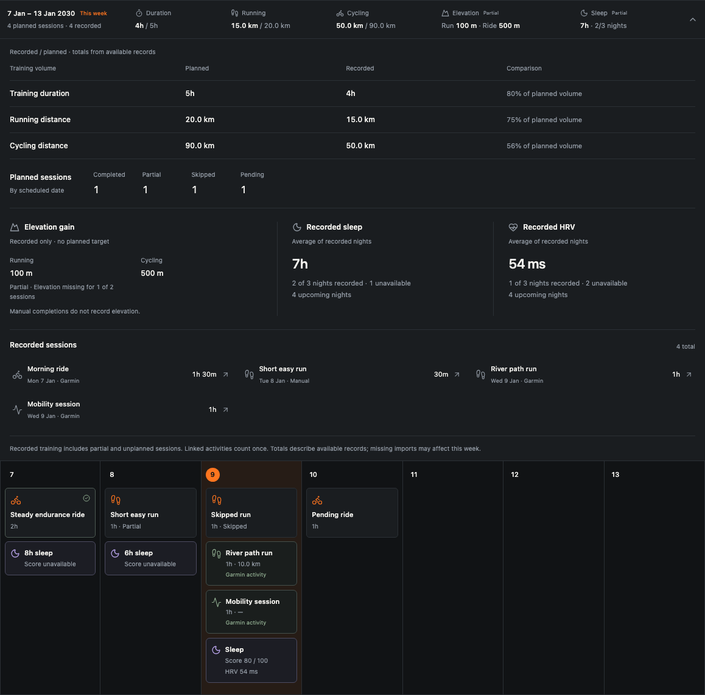

# Athlete Panel

**A self-hosted home for your training, your progress, and the sports you love.**

Athlete Panel brings training plans, activity history and everyday context into one private workspace. The project is growing toward support for **endurance, multisport and strength training**—from trail running and cycling to triathlon and gym sessions.

Plan your sessions, import what you actually did, review your week, and adjust what comes next. Your instance stores your training and health records in PostgreSQL under your control. The current preview has dedicated running and cycling planning; broader sport support is part of the direction described below.

Start with manual planning. Add Garmin imports when you want them. Connect an external AI agent to propose changes that **you review and apply**.

[Sports and training styles](#sports-and-training-styles) · [Quick start](#quick-start) · [Garmin](#garmin-integration) · [AI agents](#ai-agent-integration) · [Contributing](#development-and-contributions) · [Documentation](#documentation)

> **Developer preview · One athlete per instance.** Local workflows are implemented and tested. Isolated container installation and recovery are exercised by the release rehearsal. Actual public HTTPS, off-host recovery and owner-account Garmin verification remain deployment gates. See the [release gates](docs/plans/mvp-execution.md#release-gates-and-remaining-environment-evidence) and [license](#license-and-acknowledgments) before adopting or redistributing the project.

## Why Athlete Panel?

Training plans, activity history and day-to-day context belong together. Athlete Panel brings them into a private workspace you can run on your own infrastructure, with no required author-operated backend, hosted database or model subscription.

Self-hosting lets you choose where records are stored, when to upgrade, how to back up, and which integrations receive access. You also take responsibility for maintaining the server and protecting its data. Garmin remains the source of imported records; an optional external agent uses the model service you choose.

## Sports and training styles

You might be preparing for your first trail race, enjoying long rides, balancing triathlon disciplines, building strength, or simply finding a consistent routine. Athlete Panel aims to make room for those different goals and for athletes of different experience levels. You do not need to race or identify with just one sport to help shape the project.

Here is what the current preview supports:

Planning now follows Garmin sport groups and subgroups, with separate hiking and mountaineering, swimming, winter sports, rowing/paddling and gym/strength selections. Rest days sit outside the sport taxonomy. Workouts can include planned elevation, intervals and ordered strength prescriptions; completion remains session-level. Unknown Garmin types remain explicitly unresolved. See [sport planning](docs/features/garmin-sport-planning.md) for the catalog source and compatibility limits.

## Key features

- **Plan your training:** individual workouts, scheduled or undated plans, structured intervals, duplication, rescheduling and explicit ordering controls. Use Garmin groups/subgroups, rest days, planned elevation and ordered strength exercises.
- **Keep context close:** notes, races, goals, availability, injury constraints, heart-rate zones and cycling FTP.
- **Record what happened:** completed, partial and skipped sessions; actual duration and distance; effort and notes. Manually link an imported activity to a workout without counting the pair twice.
- **Understand each week:** planned versus recorded duration, running/cycling distance and elevation, sleep and HRV averages, session status and clickable details. Missing measurements remain visible.
- **Import Garmin history:** activity summaries and selected health data, automatic recent sync, resumable historical imports and visible coverage/errors. Garmin groups and subgroups remain distinct; unfamiliar identities are explicitly unresolved.
- **Make the calendar yours:** light/dark themes, phone layouts, configurable week starts, timezone and metric/imperial preferences, and keyboard-accessible controls.
- **Work with external agents:** approve bounded access, review proposed training changes, apply them atomically and undo a batch when later edits do not conflict.
- **Extend your instance:** trusted source plugins, typed contracts, a scaffolder and a working cycling/sleep dashboard example.
- **Operate independently:** local background jobs, console account recovery, encrypted backup/restore tools and coordinated upgrade procedures.

## Preview

<picture>
  <source media="(prefers-color-scheme: dark)" srcset="docs/images/calendar-dark.png">
  <source media="(prefers-color-scheme: light)" srcset="docs/images/calendar-light.png">
  
</picture>

_Actual application screenshots using synthetic training and health records, captured during local browser verification. [Light view](docs/images/calendar-light.png) · [Dark view](docs/images/calendar-dark.png)._ There is no hosted public demo currently documented.

## How it works

The browser connects to your Athlete Panel web application. A separate worker processes durable PostgreSQL-backed jobs, including Garmin synchronization. The same domain validation powers manual edits and reviewed agent proposals.

For a private server, the supplied Compose configuration runs **Caddy → web app**, alongside the **worker**, **PostgreSQL** and an optional **scheduled backup service**. Caddy handles HTTPS and reverse proxying. PostgreSQL has no published port in this production configuration.

| Layer                | Technology and role                                                                          |
| -------------------- | -------------------------------------------------------------------------------------------- |
| Web interface        | TypeScript, React, Next.js, Tailwind CSS, shared shadcn/Radix primitives and Lucide icons              |
| Data and validation  | PostgreSQL 17, postgres.js, explicit SQL transactions and Zod runtime contracts              |
| Background work      | Database-backed jobs with leases, retries and persistent checkpoints                         |
| Extensions           | Build-time plugin composition with validated dependencies and separate client/server entries |
| Agent access         | Local TypeScript CLI and scoped JSON HTTP API; owner approval in the browser                 |
| Packaging and checks | pnpm, Docker Compose, Caddy, Vitest, Playwright and a GitHub Actions verification workflow   |

The architecture targets a single owner on a private instance. Team accounts, public signup, billing and a plugin marketplace are outside the current scope. See [architecture](docs/architecture.md) for boundaries and data ownership.

## Quick start

Choose the workflow that fits your goal:

| Goal                                      | Start here                                                                                                                              |
| ----------------------------------------- | --------------------------------------------------------------------------------------------------------------------------------------- |
| Run a maintained private server           | [Production Docker Compose installation](docs/development.md#private-server-installation): generated secrets, HTTPS, worker and backups |
| Try the application locally or contribute | The checkout workflow below; it runs a development server bound to your computer                                                        |
| Update an existing local checkout         | [Local update and recovery](docs/development.md#updating-a-local-checkout); setup does not upgrade existing data                        |

This route runs the web app and worker on your computer, with PostgreSQL in Docker. It needs no Garmin or AI credentials. The shell examples assume a Unix-like terminal.

**Prerequisites:** a maintained Node.js **22** release (minimum **22.13**, use current security patches), pnpm **11.28.8**, and a running Docker Engine/Desktop with Compose v2. If pnpm is missing, install the version pinned in `package.json`: `npm install --global pnpm@11.28.8`.

### 1. Install and set up

Clone or download this repository, open a terminal in its root, and run:

```sh
pnpm install --frozen-lockfile
pnpm run setup
```

Setup checks your tools, generates private database passwords and an encryption key, starts PostgreSQL in Docker, and initializes the database. **You only choose and confirm your login password** (12–256 characters). Your password is visible in the terminal while you type and confirm it.

There is no need to copy `.env.example`, generate keys, construct database URLs or load environment variables manually. Generated settings are saved in an owner-readable `.env` file excluded from Git. Keep a separate private recovery copy: its encryption key is needed to recover encrypted Garmin credentials. Backups are configured separately.

Setup can resume an interrupted fresh installation. Running it again preserves existing credentials, data and your account. It does not automatically upgrade an existing database. If storage exists but `.env` is missing, it stops and explains how to recover the configuration.

### 2. Run Athlete Panel

```sh
pnpm run local
```

This loads the saved configuration, ensures PostgreSQL is running, and starts **the web app and background worker together in one terminal**. Administrative credentials are kept out of both application processes.

Open **[http://127.0.0.1:3000](http://127.0.0.1:3000)** and sign in with your chosen password. `http://localhost:3000` also works locally; use the same address consistently because login cookies belong to that hostname. You can start planning immediately; Garmin and AI connections are optional.

Press **Ctrl+C** to stop the web app and worker. PostgreSQL stays running and its Docker volume retains your data. Run `pnpm run local` again next time; you do not need to repeat setup. The worker must stay running for imports and automatic synchronization; the browser tab can be closed.

After your first sign-in, welcome setup helps you confirm your timezone, units and first day of the week, then optionally connect Garmin. Imports continue in the background. You can close setup and resume it from Settings; existing installations can choose **Run welcome setup** there.

These commands target macOS/Linux terminals; Windows users need WSL2 with Docker integration. See [local setup troubleshooting](docs/development.md#local-setup-troubleshooting) for existing configuration, occupied ports and interrupted startup. The [development and operations guide](docs/development.md) owns advanced commands and recovery procedures.

## Installation and configuration

### Hosting on your server

The recommended VPS workflow uses a **prebuilt release image** with a small deployment bundle. Your server needs **Linux, Python 3.10+ and Docker Compose**, a domain and mounted off-host backup storage. No application checkout, Node, pnpm or build is required on the server.

**Release availability:** this repository implements the workflow; no official image or downloadable release bundle has been published yet. Use a trusted image/bundle supplied by the maintainer, or the [custom/source build path](docs/development.md#custom-images-and-source-upgrades). From an extracted release bundle:

```sh
python3 scripts/hosted.py install --domain training.example.com --backup-directory /mnt/offsite/athlete-panel
```

You choose your login password. Setup generates technical credentials, applies database migrations, configures HTTPS and starts verified daily backups. It preserves private operator state separately from the checkout. The [server guide](docs/development.md#private-server-installation) covers prerequisites, recovery keys and troubleshooting. The local development launcher is not the public deployment method.

For later releases, download and extract the new deployment bundle into a separate directory, then run from that directory using the same account and persistent state:

```sh
python3 scripts/hosted.py upgrade
```

The updater prepares the image before downtime, takes a verified backup, runs migrations and checks readiness before reopening the application. Interrupted operations have a saved phase and a `resume` command. Recovery uses the archive’s matching image and restores data into a **new database**, preserving the old one. Archived source remains available for custom builds and older backups. Custom plugins require a custom image; updates check for accidental plugin removal before downtime. See [upgrades](docs/development.md#coordinated-upgrades-and-plugin-activation) and [recovery](docs/development.md#restore-and-owner-recovery). Public HTTPS renewal and recovery on actual independent infrastructure remain [release checks](docs/release-readiness.md).

The following configuration reference is for advanced/manual deployments; the guided workflow generates these values:

| Setting                                                    | Purpose                                                                                                                                                                               |
| ---------------------------------------------------------- | ------------------------------------------------------------------------------------------------------------------------------------------------------------------------------------- |
| `DATABASE_URL`                                             | Host-side database connection; production Compose builds its internal URL from the PostgreSQL settings                                                                                |
| `ADMIN_DATABASE_URL`, `POSTGRES_PASSWORD`                  | Administrative access for console setup/migrations/recovery; generated by local setup                                                                                                 |
| `APP_DATABASE_PASSWORD`                                    | Separate restricted application password, generated by local setup; changing a file alone does not rotate an initialized database password                                            |
| `ENCRYPTION_KEY`                                           | Application key for encrypting provider credentials; retain a separate recovery copy                                                                                                  |
| `APP_ORIGIN`, `COOKIE_SECURE`                              | Canonical browser origin and session-cookie policy; local HTTP permits the two loopback names described above, while production Compose uses an exact HTTPS origin and secure cookies |
| `ATHLETE_PANEL_DOMAIN`, `ATHLETE_PANEL_RELEASE`            | Server hostname and distinct local image tag for a deployment                                                                                                                         |
| `BACKUP_DESTINATION`, `BACKUP_KEY_FILE`, `BACKUP_HOUR_UTC` | Backup storage, separate encryption-key file and UTC schedule                                                                                                                         |

[`.env.example`](.env.example) lists the settings. The [configuration reference](docs/development.md#prerequisites-and-configuration) explains defaults, key requirements and test-only variables. `pnpm run setup` and `pnpm run local` load configuration themselves. Advanced standalone administrative scripts need the explicit environment loading described in the guide; Compose reads `.env` itself.

### Backups, updates and recovery

Backup tooling creates encrypted archives containing the database and matching source/composition/configuration metadata. Secret files and encryption keys are excluded. Guided hosted installation enables the backup service automatically; manual Compose installations enable its profile explicitly; storing an archive on the same server is not off-host recovery.

Before an upgrade, enter maintenance, create and verify a matched backup, stop the application processes, validate the candidate composition, apply migrations and check readiness before reopening writes. Code rollback requires compatible persisted contracts and schema; otherwise restore the matched snapshot. Follow the [upgrade procedure](docs/development.md#coordinated-upgrades-and-plugin-activation) and [backup policy](docs/development.md#backup-policy-and-monitoring).

## Garmin integration

Athlete Panel uses **Garmin's official Garmin Connect Personal API**, which Garmin provides for individuals accessing their own data. This is distinct from Garmin's commercial, multi-user developer integrations. The application uses a personal API key; it does not scrape Garmin Connect or ask for your Garmin password. See [Garmin's Personal API documentation](https://developer.garmin.com/gc-developer-program/personal/personal-api/) and [Personal API FAQ](https://developer.garmin.com/gc-developer-program/personal/personal-faq/).

1. Create a Personal API key in Garmin Connect using Garmin's instructions and terms.
2. In Athlete Panel, open **Garmin import** and enter the key.
3. Keep the worker running. Recent data imports first, followed by historical traversal; watch progress and coverage in the application.

The server exchanges the key for a short-lived bearer token and obtains a new token when needed. Garmin documents a maximum token lifetime of 24 hours, bounded by key expiry, with no refresh token. [Authentication details](https://developer.garmin.com/gc-developer-program/personal/personal-faq/).

| Imported data | Available in Athlete Panel                                                                     |
| ------------- | ---------------------------------------------------------------------------------------------- |
| Activities    | Sport, recorded date/time, duration, distance, elevation and available summary heart-rate data |
| Sleep         | Total duration, Deep/Light/REM/Awake durations and sleep score                                 |
| Daily health  | Resting heart rate, overnight HRV, steps, stress and Body Battery                              |

With automatic synchronization enabled, the worker schedules a recent import about every hour and refreshes the latest seven days to catch corrections. History imports are duplicate-safe and resumable. Activity pagination has no application start-date cutoff; health scans use an internal January 1, 2000 boundary and continue through empty windows. Long scans can take time, especially under rate limits.

**Coverage depends on Garmin, the account and the device.** Completing traversal does not prove that every historical record or metric was available. Missing values, unsupported streams and failures are surfaced. Disconnecting removes credentials and stops sync while retaining imported history.

Imports are read-only: there is no Garmin workout/plan export, FIT analysis or GPS-track storage. Using an official API does not imply Garmin endorsement of Athlete Panel. Field mappings, failure behavior and verification limits are documented in [Garmin import and health](docs/features/garmin-import.md).

## AI agent integration

Athlete Panel separates **training assistance** from **application development**. Both use an external agent of your choice; the application has no embedded chat, model SDK or required AI subscription.

### Propose training changes

From a local checkout with dependencies installed:

```sh
pnpm agent connect --url http://127.0.0.1:3000
```

The CLI opens the approval page. Sign in, compare the displayed code with your terminal, choose the dates and access duration, decide whether to include private notes, and approve. No token copying is needed. For a remote instance, supply its HTTPS origin; `--no-open` prints the link when automatic browser opening is unavailable.

Then ask your agent:

> Read the training-planning skill linked in AGENTS.md. Review my recent training and availability, and propose adjustments to next week's pending workouts. Explain the changes for my review.

The training skill loads the [coaching workflow](.agents/skills/athlete-panel-training-coaching/SKILL.md) for program creation and workout adjustments. The agent reads your context first, asks brief questions only when missing answers would materially change the plan, and proceeds directly when it has enough information. For a request such as “Generate a three-month trail-running program,” it clarifies unresolved goals, dates, availability, terrain and constraints, then prepares the requested program. Essential questions wait for your answer; minor assumptions are stated. This conversation happens in your agent, without requiring a special planning mode. Your answers do not apply calendar changes.

The agent can use:

```sh
pnpm agent context --out context.json
pnpm agent propose --file proposal.json
```

The agent prepares the proposal file using the [training skill](.agents/skills/athlete-panel-training-planning/SKILL.md) and shared schemas. You review the exact diff in **Agent workspace** and apply it yourself. Validation, scope and freshness checks run again at application time; a stale or invalid batch writes nothing.

The CLI saves its credential in `~/.config/athlete-panel/agent.json` with owner-only file permissions. It is **not encrypted on disk**. Grants expire, can be disconnected in the app, and permit bounded reads and proposals—not applying changes, editing recorded completion, managing credentials or deploying code. Context and proposal files can contain personal data; keep them private and out of version control.

### Build a personal extension

Ask a coding agent to read the [plugin-development skill](.agents/skills/athlete-panel-plugin-development/SKILL.md), then describe the feature you want. For example:

> Add a dashboard comparing weekly cycling duration with average recorded sleep. Use public contracts, show missing-night coverage, and preview it with synthetic data.

The [cycling/sleep example](personal-plugins/cycling-sleep) demonstrates this architecture. New code requires review, composition validation, a build and restart. Installed features continue working after the agent exits.

### Supported interfaces

| Interface         | Current support                                                                        |
| ----------------- | -------------------------------------------------------------------------------------- |
| CLI               | Browser connection, bounded context export and proposal submission                     |
| HTTP API          | `GET /api/agent/context` and `POST /api/agent/propose` with a scoped bearer credential |
| Repository skills | Canonical `.agents/skills/` instructions and generated `.claude/skills/` adapters      |
| MCP               | Not implemented                                                                        |

Skill files can be read by other harnesses; automatic discovery depends on the installed harness and has separate verification gates. This is a documented CLI/HTTP workflow, not a claim of universal agent compatibility. See [agent training](docs/features/agent-training.md) and the [CLI reference](docs/development.md#external-agent-cli).

## Using your workspace

- **Plan a week:** set your timezone, units and week preference in Settings; create workouts in Calendar or arrange a block in Training plans.
- **Record a session:** log completion, actuals and effort manually, or import Garmin activities and explicitly link a matching activity.
- **Review and adjust:** expand a week header to compare planned and recorded training, inspect sleep details, then revise pending sessions yourself or review an agent's proposal.

## Privacy and security

Your database runs on your infrastructure. The application does not require an author-hosted account service or model backend. Self-hosting gives you control over storage and access; it does not automatically secure a server.

- **Credentials:** Garmin keys and cached tokens are encrypted at rest with AES-256-GCM using the server-held application key. Owner passwords use salted scrypt hashes; session and grant tokens are hashed in storage.
- **Access:** one owner account, revocable sessions, login throttling and browser-origin checks protect the application. Console recovery revokes sessions and agent grants. Use HTTPS for remote access.
- **Agent sharing:** selected context may be sent to the external agent's model provider. Private narrative notes are excluded by default; applicable goals and injury constraints are still shared. Review the scope before approval.
- **Host authority:** API grants constrain the HTTP workflow. They do not sandbox an agent that also has access to server files, database credentials or your operating-system account. Source plugins likewise run as trusted code.
- **Recovery:** protect `.env`, local agent configuration and exported context. Keep application and backup keys separately recoverable, enable off-host backups, and test restoration.

No private vulnerability-reporting channel is configured in the repository yet. Do not put credentials, real health records or sensitive exploit details in a public issue.

## Development and contributions

Athletes and developers are both welcome to contribute. Share how you train, where the current workflow falls short, or what would make the application easier to use. Feedback from trail runners, cyclists, triathletes, strength athletes and people combining disciplines will help shape broader sport support.

Bug reports, documentation improvements, accessibility work and focused feature contributions are welcome. For a substantial change, start with an issue describing the problem and proposed scope. Include reproducible steps and synthetic examples in bug reports; keep personal records out of attachments. Licensing and a private security contact still need to be established for public contributions.

Use the quick start for local development and read [AGENTS.md](AGENTS.md), the [architecture](docs/architecture.md) and the relevant feature specification before changing behavior.

```text
apps/web/              Next.js web entry point
apps/worker/           Durable job runner
packages/host/         Authentication, jobs, migrations and infrastructure
packages/contracts/    Shared runtime schemas and TypeScript types
packages/plugin-sdk/   Plugin metadata and composition validation
packages/ui/           Shared components and workspace interfaces
plugins/               Bundled application features
personal-plugins/      Owner-maintained extensions
instance/              Pinned composition and generated registries
scripts/               Development and operational tooling
tests/                 Unit, PostgreSQL integration and browser checks
```

Keep feature behavior in plugins and public contracts in the shared package. Use synthetic fixtures, preserve immutable migrations, and update the relevant documentation. The [plugin guide](docs/features/plugins.md) covers extension boundaries, scaffolding and activation.

Run the standard checks from the repository root:

```sh
pnpm check
pnpm build
```

`pnpm check` covers generated-file drift, import boundaries, types, unit tests and documentation. Database integration and browser tests are separate: follow the [verification guide](docs/development.md#verification) to create isolated test storage. Never point tests or demo seeding at a personal instance. The [CI workflow](.github/workflows/verify.yml) defines checks for pushes and pull requests; its presence is not evidence of a successful hosted CI run.

## Roadmap and current limits

The product direction is one personal training workspace across endurance, multisport and strength disciplines. Areas to develop include expanding the sport model, swimming and combined-session planning, richer trail-running workflows, and strength-specific exercises, sets, repetitions and loads. These capabilities are not implemented in the current preview.

Alongside that direction, the immediate release priority is a reproducible public installation. The [execution record](docs/plans/mvp-execution.md#release-gates-and-remaining-environment-evidence) tracks the evidence still needed:

- Complete application-image build and Compose startup verification.
- Rehearse Linux deployment, HTTPS, off-host backup delivery and fresh-instance recovery.
- Expand account/device-specific Garmin conformance and historical-coverage checks.
- Record real harness discovery and browser-launch behavior on supported environments.
- Measure representative history performance and restore times.

Workout libraries, automatic activity matching, advanced training-load/recovery calculations, FIT/GPS analysis, offline editing, native notifications and MCP remain deferred. They are not release commitments. The current application is an online, English-language web workspace for one athlete.

## Documentation

| Guide                                                           | What you will find                                                                                   |
| --------------------------------------------------------------- | ---------------------------------------------------------------------------------------------------- |
| [Development and operations](docs/development.md)               | Setup, configuration, canonical commands, verification, installation, backups, upgrades and recovery |
| [Guided VPS operations](docs/features/hosted-operations.md)     | Installation, verified backups, checkpointed upgrades and matched recovery                           |
| [Guided local setup](docs/features/local-setup.md)              | Generated credentials, password prompts, combined startup and existing-data protections              |
| [First-time onboarding](docs/features/first-time-onboarding.md) | Welcome setup, preferences, optional Garmin connection and saved progress                            |
| [Architecture](docs/architecture.md)                            | Processes, ownership, contracts, data boundaries and trust                                           |
| [Shared interface](docs/features/shared-ui.md) | Component ownership, themes, modal behavior and migration constraints |
| [Garmin sport planning](docs/features/garmin-sport-planning.md) | Sport hierarchy, rest, elevation, strength, notes and recorded metrics |
| [Training workspace](docs/features/training-workspace.md)       | Planning, calendar, completion, linking, cards and weekly summaries                                  |
| [Garmin import and health](docs/features/garmin-import.md)      | Authentication, normalized records, history traversal, coverage and limits                           |
| [Reviewed agent training](docs/features/agent-training.md)      | Grants, context, proposal review, atomic apply and undo                                              |
| [Plugins and skills](docs/features/plugins.md)                  | Source extensions, templates, compatibility and agent workflows                                      |
| [Runtime contract reference](docs/reference/contracts.json)     | Generated command and data schemas                                                                   |
| [Execution record](docs/plans/mvp-execution.md)                 | Implementation progress, actual verification and deployment gates                                    |

Contributor instructions live in [AGENTS.md](AGENTS.md). Architectural decisions cover [private persistence](docs/decisions/001-private-instance.md), [plugin composition](docs/decisions/002-source-plugins.md) and [agent mutations](docs/decisions/003-reviewed-proposals.md). The [framework](docs/Framework-Guide.md), guides, templates and design references remain available.

## License and acknowledgments

Athlete Panel is available under the [MIT License](LICENSE). You may use, modify and redistribute it, including commercially, provided you retain the copyright and license notice. See the [licensing decision](docs/decisions/004-mit-license.md) for its scope and rationale.

Third-party dependencies and separately licensed materials retain their own licenses. Athlete Panel builds on the open-source tools listed above. Garmin supplies the Personal API and its documentation. Garmin and Body Battery names belong to their respective owners; this independent project makes no Garmin endorsement claim.

For focused contributions, read [CONTRIBUTING.md](CONTRIBUTING.md). Report vulnerabilities privately using [SECURITY.md](SECURITY.md). Maintainers should complete the [public release checks](docs/release-readiness.md) before publishing a release.
