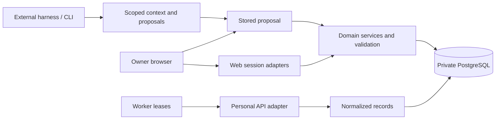

# Architecture: Athlete Panel

## Purpose and boundary

Athlete Panel serves one owner on one independent private instance. It owns manual training, normalized imported records, scoped proposal review, and operational state. Garmin supplies imported facts; an external development harness may create source plugins or propose training changes. Neither system controls owner approval. No author-operated backend or model API is required.

Authority: the owner approved implementation of the private MVP plan in this chat on 2026-10-24. The [execution record](plans/mvp-execution.md) preserves that dated statement; no durable conversation URL is available.

## Current structure

Evidence: source inspection of this checkout, with actual verification tracked separately in the execution record.

The local setup/launcher in `scripts/setup.ts` and `scripts/local.ts` owns credential generation, private configuration loading and host-process supervision. It reuses host migrations and owner bootstrap; normal web/worker children receive only runtime credentials. Existing owner databases use explicit local:ops maintenance/backup/migrate commands or the production coordinated upgrade procedure; normal startup never migrates them. A separate hosted generator creates fresh deployment secrets without starting services. See [local setup](features/local-setup.md).

Local operation uses the [persistent PostgreSQL container](../compose.local.yml), bound only to `127.0.0.1:55440`, while web and worker processes run on the host. Docker's named volume retains database contents across container restarts. The disposable test database uses a separate Compose project and port 55439. [Production Compose](../compose.yml) additionally packages web, worker, HTTPS ingress and scheduled backups.

| Area             | Responsibility                                                                             | Entry point                                                                   |
| ---------------- | ------------------------------------------------------------------------------------------ | ----------------------------------------------------------------------------- |
| Web              | Generic routing, owner session adapters, rendered plugin pages                             | [Application](../apps/web/app)                                                |
| Worker           | Durable lease claims, plugin schedulers and jobs                                           | [Worker](../apps/worker/index.ts)                                             |
| Host             | Sessions, encrypted secrets, repositories, jobs, migration checks, lifecycle               | [Host](../packages/host/src)                                                  |
| Contracts        | Runtime Zod schemas and inferred public types                                              | [Contract source](../packages/contracts/src/index.ts)                         |
| Shared UI        | Owned shadcn/Radix controls, theme mapping, compatibility wrappers, tooltip/confirmation provider | [UI package](../packages/ui/src/index.ts) |
| SDK              | Metadata, compatibility, dependency and route validation                                   | [SDK](../packages/plugin-sdk/src/index.ts)                                    |
| Composition      | Pinned manifests, generated client/server registries, domain service wiring                | [Instance](../instance/composition.json), [services](../instance/services.ts) |
| Athlete/training | Profile, constraints, prescriptions, dates/order, completion and audit                     | [Athlete](../plugins/athlete), [training](../plugins/training)                |
| Records/Garmin   | Normalized records and account-bound Personal import                                       | [Records](../plugins/activity-records), [Garmin](../plugins/garmin)           |
| Calendar/health  | Workspace and factual daily projections                                                    | [Calendar](../plugins/calendar), [health](../plugins/health)                  |
| Agent bridge     | Browser-approved CLI pairing, scoped exports, immutable proposal review, atomic apply/undo | [Bridge](../plugins/agent-bridge/service.ts)                                  |
| Owner extension  | Weekly cycling duration and recorded sleep comparison                                      | [Personal plugin](../personal-plugins/cycling-sleep)                          |

The web root installs the shared UI provider and Tailwind discovers the UI package source. Shared semantic styles map to the existing `data-theme` palette through prefixed tokens. Plugins import public components and retain all domain composition and calculations. Workout editors mount above responsive inspector boundaries; a nested editor defers its inspector's 1050px mode switch. See [shared UI](features/shared-ui.md) and [ADR 007](decisions/007-shared-shadcn-ui.md).

The browser calls versioned-domain v1 schemas through HTTP adapters. Manual operations and agent application use the same pure training engine: focused handlers share one batch context and finalizer. The instance-level commit helper persists changes and audit within the caller-owned transaction; undo keeps its distinct validation sequence. A PostgreSQL advisory transaction lock serializes domain writes, imports and context freshness checks for this single-owner workload. Revisions reject stale edits. Audit, idempotency records and domain changes commit together. Records stay in their owning schemas; `instance/services.ts` composes repository services without exposing ORM rows as public contracts.

## Significant interfaces and constraints

- The required athlete plugin contributes authenticated onboarding through the generic workspace slot. Host settings hold versioned owner progress; new bootstrap marks pending and the additive athlete migration classifies prior owners. The application coordinator merges only three preference fields and commits the domain audit and progress in one transaction. Completion is terminal, with explicit resume for deferred/existing owners. Garmin key entry is an enabled plugin contribution; stored credentials and verified/import states remain separate. The owner-only lightweight status adapter supplies progress, worker heartbeat and sanitized Garmin job state. See [first-time onboarding](features/first-time-onboarding.md).

- The athlete profile owns the optional week-start preference; shared UI calendar helpers resolve Automatic from the browser locale and align the workspace range for calendar and summary plugins. Existing profile/audit JSON stays readable without a migration.
- Calendar cards project existing workspace DTOs into account/date-grouped sleep, activity and context details. Opening details is read-only; explicit context edits reuse the existing training services. No extra storage or provider calls are introduced.
- Each calendar week renders training-owned volume/elevation totals, scheduled-status counts and deduplicated chronological session previews. Calendar-owned sleep/HRV coverage projections share corrected daily metrics with sleep cards; HRV coverage is independent of sleep availability. The responsive header opens existing activity details and workout inspectors. Summaries are derived from existing bounded workspace DTOs; missing metrics and future nights remain explicit. These read-only views introduce no persisted summary or new provider dependency.
- Dates are validated floating calendar dates; provider UTC timestamps and historical local dates stay distinct. Quantities use seconds, meters, watts, bpm and HRV milliseconds. Missing values remain null.
- Host code contains no training rules or provider transport. Bundled plugins are trusted in-process code; metadata capabilities are declarations, not a sandbox.
- Browser-approved agent connections are persisted in `agent_bridge.connections`. Public initiation grants no authority; authenticated owner approval creates the scoped grant. The CLI alone receives the secret and stores it privately. Requests expire after ten minutes and never renew access automatically.
- The external harness owns coaching clarification through the canonical [coaching skill](../.agents/skills/athlete-panel-training-coaching/SKILL.md), loaded by the [training-planning skill](../.agents/skills/athlete-panel-training-planning/SKILL.md) after scoped context retrieval. Questions and answers remain in that conversation; the server receives the existing typed proposal. This adds no host coaching rules, intake persistence or embedded model orchestration, and answers never replace owner application of the exact proposal.
- Generated client imports never include server transports, database credentials or provider keys. A resolved TypeScript dependency graph enforces this transitively. Public plugin entries separate shared, client and server APIs; Training consumes contracts and instance services, while Athlete and Activity Records declare their Training interface dependency. AES-GCM secrets require a separately recoverable encryption key.
- PostgreSQL-backed repositories read and write through one postgres.js client: transactions for writes, the shared pool for reads outside a transaction.
- Read APIs bound activity/health dates; linked activity identities may additionally be loaded to validate relationships. Manual plan tables remain small-instance collections. Large training histories would justify additional pagination/indexed projections.
- Migrations are immutable/checksummed and applied under an exclusive lock, host first then dependency order; registry generation and execution share the ordered host migration list. Web readiness and worker startup reject a different installed composition. Failed migration transactions do not activate a candidate.
- Source composition requires build, migration coordination, deployment and restart. Desired UI state remains pending until the compiled composition is activated. Disabled code retains its data.

Garmin owns per-stream scan coverage, sanitized rejection diagnostics and resumable recovery cursors. The host supplies generic job priorities, bounded retries and isolated plugin scheduling. Proposal context snapshots remain in the existing host proposal envelope; the bridge owns seven-day expiry, on-demand review and transactional digest revalidation ([ADR 009](decisions/009-durable-proposal-review.md)).

## Behavior and decisions

Canonical rules live in [training](features/training-workspace.md), [Garmin](features/garmin-import.md), [agent training](features/agent-training.md), and [plugins](features/plugins.md). Operational commands and recovery steps live in [development](development.md).

Accepted decisions cover [private PostgreSQL](decisions/001-private-instance.md), [source plugins](decisions/002-source-plugins.md), [reviewed proposals](decisions/003-reviewed-proposals.md), and [release image identity and recovery](decisions/006-release-images.md).

## Gaps and transitions

Provider tests cannot establish an owner's actual permission, retention, or throttling behavior. Account-specific conformance is a release gate. Public HTTPS, off-host backup delivery, measured production restore time, and exact private-server sizing require the deployment environment. Track these separately from local implementation in the [execution record](plans/mvp-execution.md).

## Release access boundaries

Production web/worker/backup processes use a dedicated restricted PostgreSQL role; administration is confined to console `admin`/`recovery` services. Migrations remain checksummed and immutable. Browser mutations require the configured origin. The only alias allowance is local HTTP between `localhost` and `127.0.0.1` at the same port, with secure cookies and trusted proxy mode disabled; hosted/HTTPS instances remain exact. Login attempts are limited by a hashed source identity supplied by the trusted Caddy ingress, with IPv6 /64 grouping; raw web ports must stay private. Password verification uses asynchronous scrypt with bounded concurrent checks. Docker builds copy declared source roots instead of the entire checkout. Operational status is sanitized host-owned settings data and does not expose provider secrets. See [security policy](../SECURITY.md) and [release checks](release-readiness.md).

Operational follow-up: worker heartbeat is recorded after successful scheduling/job iterations; failures persist only sanitized state/count/timestamps in host settings. No new table or destructive migration is required. Garmin coverage has an owner-only paginated operation; the original normalized records/checkpoints remain authoritative. Profile/workout draft snapshots preserve original revisions across workspace refreshes. Runtime containers retain source for matched backups and production dependencies plus PostgreSQL client tools, while build/test tooling remains in the build stage.

Agent enrollment uses persistent host-owned admission counters with plugin-owned limits; credential preflight precedes domain locking and transactional authorization remains authoritative. Runtime password upgrades use the narrowly granted function in [ADR 010](decisions/010-runtime-password-upgrade.md), sharing the recovery lock with final session creation while keeping hashing outside locks. Direct owner-table writes remain administrative.

## Hosted operational controller

The Python standard-library controller in `scripts/hosted.py` coordinates the existing Compose services and console scripts. Operator state is private and separate from source: generated credentials, immutable image IDs, selected database, storage identity and resumable operation checkpoints. It does not run a second server or expose an administrative API. Image pulls/builds occur before maintenance; migration SQL remains owned by the host/plugin runner. Permission refresh has a distinct failure phase after the SQL commit. Workers report a healthy maintenance pause without scheduling imports.

Backup storage verification combines the expected remote filesystem identity with a marker. Archives are read back and authenticated before publication as complete; unregistered/local backups remain explicitly unverified for off-host protection. Recovery authenticates first, creates a new database, selects its authenticated matching image (or rebuilds archived source) and verifies a functioning restored application before switching. The controller retains previous images/databases and never performs down migrations or automatic cleanup of owner recovery points. See [hosted operations](features/hosted-operations.md) and the [operating guide](development.md#private-server-installation).

Release images contain generated protocol/composition/source-fingerprint metadata. The hosted controller stores both the immutable local image ID and portable registry digest; rendered Compose never follows mutable tags. Backups authenticate this identity alongside their matched source, also supporting local source-only archives without an image identity. A small digest-pinned deployment bundle carries the controller without a checkout. Source/local-image selectors retain custom build workflows; changing publishers or removing installed plugins requires explicit review before maintenance. These are console/deployment boundaries, not new runtime services or SQL tables.

[ADR 012](decisions/012-deployment-recovery.md) extends this boundary with an exact-image CI handoff and an isolated rehearsal module. CI builds one AMD64 artifact; its checksum, local image ID and full commit bind the three container rehearsals to publication. Only the gated publication job can write packages/releases. A preparation snapshot is restored and migrated on a private internal Docker network before live maintenance. Final deployment recovery uses a second snapshot after mutation draining. The runner composes explicit disposable resources rather than inheriting live volumes or database credentials, and calls existing schema/instance/domain validators. Web/worker/backup move together while PostgreSQL and unchanged ingress retain their containers.

The backup container remains the sole daily scheduler. Creation and retention share an advisory lock; the controller observes its first matching startup attempt after reopening, without another manual backup. Optional private HTTPS heartbeat configuration is mounted only into backup services; sanitized notification status stays in host settings. The external monitor owns overdue detection. Operation and rehearsal records preserve phase timings/results; manual restore tests reuse the same runner and cleanup labels. No monthly schedule, public endpoint or new training rules are introduced.

## Sport identity and expanded prescriptions

The [Garmin hierarchy decision](decisions/011-garmin-sport-hierarchy.md) keeps pinned taxonomy and runtime contracts in `packages/contracts`; training owns prescription/link validation, Garmin owns provider normalization, and activity/calendar plugins own their existing review surfaces. Rest is a planning kind outside the provider taxonomy. Historical reimport enriches activity JSON and linked actuals transactionally; unknown classification never enables automatic linking. Optional JSON fields require no SQL schema migration, but old-release rollback may require its matched backup.
